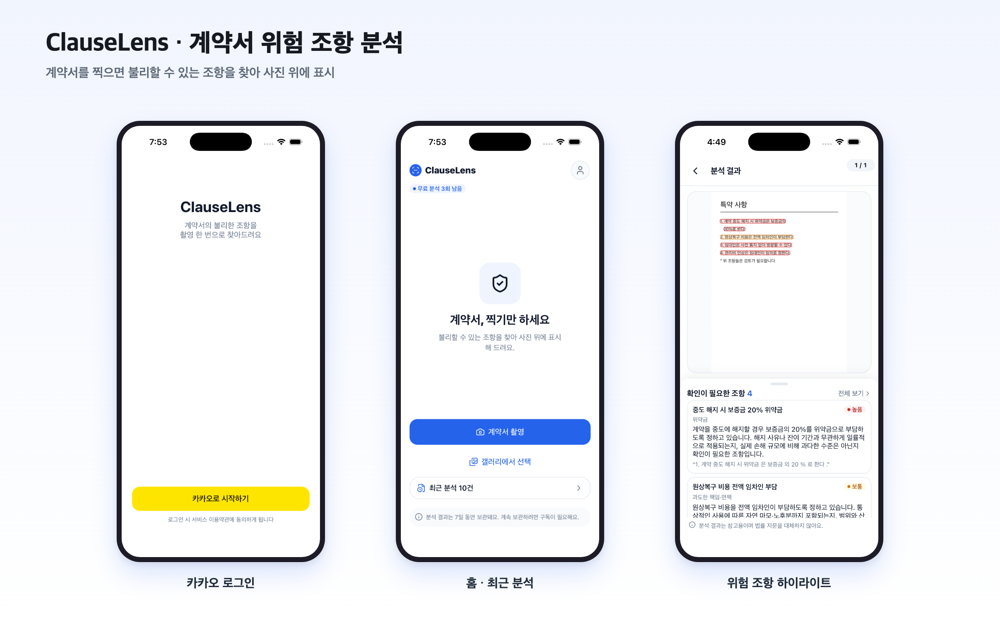
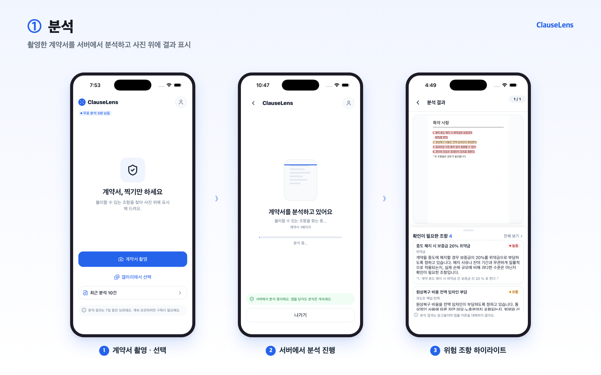
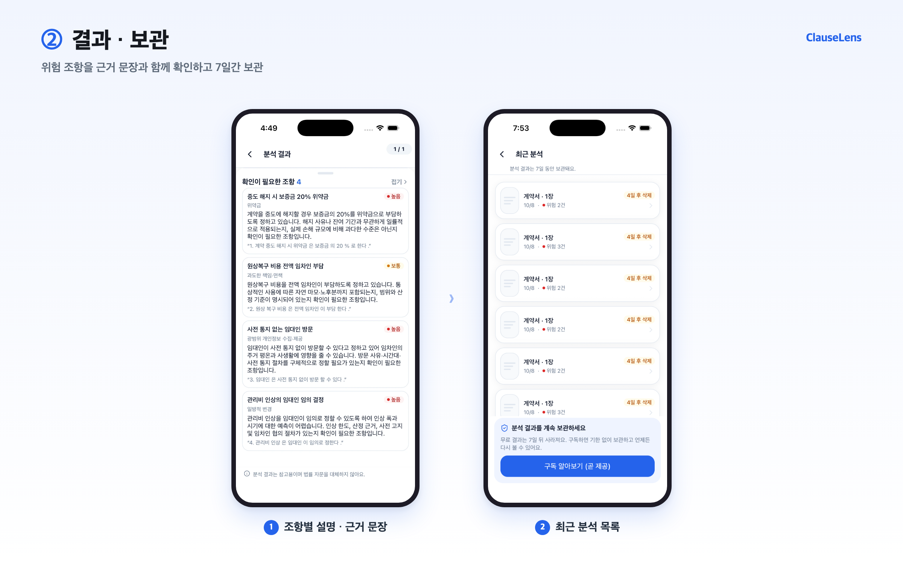
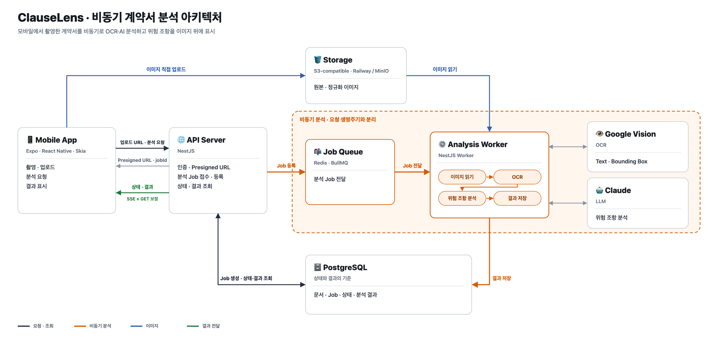

<div align="center">

# 📸 ClauseLens

**계약서를 촬영하면, 확인이 필요한 조항을 원본 이미지 위에 표시하는 모바일 앱**

2인 팀 프로젝트 · 개발 전담 (앱 · API · Worker · 인프라) · 2026.09 – 2026.10 · MVP 개발 완료 (미배포)

<br>

[📘 포트폴리오 (Notion)](https://shaded-badger-c05.notion.site/ClauseLens-3eddeddc12a781269cc2e96862e1e4b1) · [🗂️ 개발 기록 (Notion)](https://shaded-badger-c05.notion.site/OCR-3d1deddc12a780f0bb7fc1f8403287a5)

<br>


<br><br>

사용자가 계약서를 촬영하면 서버가 OCR로 텍스트와 좌표를 추출하고 위험 조항을 분석합니다.<br>
분석 결과는 원본 사진 위에 하이라이트로 표시되며, 구역을 탭하면 조항 설명과 근거 문장을 확인할 수 있습니다.<br>
분석 결과는 7일간 보관됩니다.

<br>






</div>

> [!WARNING]
> ClauseLens의 분석 결과는 **참고 정보이며 법률 자문을 대체하지 않습니다.** 중요한 계약은 변호사 등 전문가의 검토를 권장합니다.

---

## 해결한 문제

**🔁 동시성 제어** — 동시 요청에도 무료 분석 횟수가 한 번만 차감되도록 예약 · 정산 구조를 설계했습니다.

**🎯 좌표 정합** — OCR 좌표를 원본 사진 위 하이라이트와 터치 영역에 정확히 맞췄습니다.

**⚙️ 비동기 파이프라인** — 오래 걸리는 OCR · AI 분석이 연결이 끊겨도 이어지도록 구성했습니다.

2인 팀에서 개발을 전담해 앱 · API · Worker · 인프라를 모두 구현했습니다.
아래 작업 내용은 위 항목과 같은 순서로 구성했습니다.

---

## 작업 내용

<details>
<summary><b>🔁 동시성 제어</b> — 가용 1회 기준 동시 8건 중 예약 1건, 중복 차감 버그를 통합 테스트로 발견 · 수정</summary>

<br>

**문제** — 1회 남은 사용자가 동시에 두 번 요청하면 둘 다 통과해 무료 횟수가 음수가 될 수 있었습니다.

**과정**
- 접수 시 조건부 UPDATE로 횟수를 원자적으로 예약하고, 분석이 완료된 경우에만 차감했습니다.
- 실패 · 부분 완료는 예약을 해제하고, jobId 원장과 문서 잠금으로 중복 예약 · 정산을 차단했습니다.
- PostgreSQL 통합 테스트(7개 시나리오 · 13개 판정)에서 중복 차감 버그를 발견해 조건부 상태 전이로 수정했습니다.
- 가용 1회 기준 동시 8건 중 예약 1건, 동일 문서 6건 중 Job · 예약 각 1건을 확인했습니다.

**배운 점**
- 확인과 차감 사이에 다른 요청이 끼어들 수 있어, 두 단계를 한 번의 조건부 쿼리로 묶어야 했습니다.
- 동시성 버그는 단위 테스트에서 드러나지 않았고, 실제 DB 통합 테스트에서 발견됐습니다.
- 같은 원칙을 결제 웹훅 중복 수신, 업로드 중복 요청, 재시도 작업 중복 실행 방지에도 적용했습니다.
- 진행 중인 작업이 가용 횟수를 일시 점유하는 비용이 있었습니다.

<sub>자세히 → [인증·이용 권한](agents/context/auth-entitlement.md)</sub>

</details>

<details>
<summary><b>🎯 좌표 정합</b> — OCR 좌표 기준을 정규화 이미지로 통일하고, 이미지 · 위험 구역을 같은 Skia Canvas에 렌더링</summary>

<br>

**문제** — 휴대폰 사진의 EXIF 회전 정보 때문에 OCR 좌표와 화면 속 이미지 방향이 어긋날 수 있었고, 페이지 전환 중 이전 이미지와 현재 좌표가 섞일 위험이 있었습니다.

**과정**
- Worker에서 방향을 보정한 이미지를 저장하고, 좌표와 같은 버전으로 묶어 내려줬습니다.
- 앱은 화면 비율 · 여백을 계산해 좌표를 역변환하고, 44pt 터치 영역 · 작은 영역 우선 판정을 적용했습니다.
- 24MP · 8192px 초과 이미지는 SVG로 대체 렌더링해 디코드 메모리 위험을 제한했습니다.
- 좌표 변환 · 터치 판정 단위 테스트와 실제 Vision 결과로 위치 일치를 확인했습니다.

**배운 점**
- 좌표는 값만이 아니라 어떤 이미지를 기준으로 했는지까지 함께 전달해야 의미가 있었습니다.
- 이미지와 좌표를 같은 버전으로 묶어야 페이지 전환 중 혼합을 막을 수 있었습니다.
- 정규화 이미지를 따로 저장하면서 저장 · 디코드 비용이 추가됐습니다.

<sub>자세히 → [하이라이트 렌더링](agents/context/highlight-rendering.md) · [프론트 아키텍처](agents/context/frontend-architecture.md)</sub>

</details>

<details>
<summary><b>⚙️ 비동기 파이프라인</b> — API와 BullMQ Worker를 분리하고 DB를 기준 상태로 두어, 연결이 끊겨도 분석 상태 복원</summary>

<br>

**문제** — 외부 OCR · AI API의 처리 시간이 일정하지 않았고, 큐 등록 실패나 재진입 · 네트워크 전환 시 상태 이벤트가 유실될 수 있었습니다.

**과정**
- 작업 ID를 먼저 반환하고, 업로드 → 분석 요청 → 큐 → Worker(Vision OCR · Claude) 순으로 처리했습니다.
- 최대 3회 지수 백오프로 재시도하고, 30초 이상 미전달 작업은 큐에 다시 등록했습니다.
- 결과 저장과 상태 변경을 한 트랜잭션으로 묶고, 상태 버전으로 늦게 도착한 응답이 최신 상태를 덮어쓰지 않도록 했습니다.
- SSE와 5초 주기 조회로 상태를 보정하고, 오류 시 2초 후 재연결했습니다.

**배운 점**
- 큐 등록 누락 · 중단 · 늦은 응답은 예외가 아니라 기본 흐름으로 보고 설계해야 했습니다.
- 이벤트를 놓쳐도 다시 조회하면 복원되도록, 상태의 기준을 DB에 두는 것이 중요했습니다.
- 큐 · 폴링 · 재등록 작업을 함께 관리해야 하는 복잡성이 늘었습니다.

<sub>자세히 → [분석 잡](agents/context/analysis-job.md) · [백엔드 아키텍처](agents/context/backend-architecture.md)</sub>

</details>

---

## 🏗️ 아키텍처

- **Mobile** — 촬영 · 업로드 · 상태 표시 · 결과 하이라이트
- **API** — 인증 · 권한 · 문서 상태 · 작업 접수
- **Worker** — OCR · 위험 조항 분석 · 결과 저장



<sub>전체 요청 흐름 → [백엔드 아키텍처](agents/context/backend-architecture.md) · [업로드·스토리지](agents/context/upload-storage.md)</sub>

---

## ⚖️ 기술 선택과 비용 검토

| 결정 | 비교 | 선택 |
| --- | --- | --- |
| 이미지 저장소 | MinIO 직접 운영 vs Railway Storage Bucket | 프로덕션 Railway Bucket · 로컬 MinIO |
| 비동기 작업 큐 | AWS SQS vs Redis + BullMQ | Redis + BullMQ |
| 모노레포 | Nx vs Turborepo | Turborepo |
| 결과 렌더링 | Image + SVG vs Skia | Skia 중심 · SVG 대체 렌더링 |

> **이미지 저장소** — MinIO를 프로덕션에서 직접 운영하면 상시 컨테이너·Volume과 백업·내구성 관리가 필요했습니다. 10GB 기준 당시 검토 비용이 **월 약 $4.5~6.5에서 약 $0.15**로 줄어 Railway Bucket을 선택했고, S3 호환 Storage Adapter로 로컬 MinIO와 같은 코드를 유지했습니다.

<sub>결정 근거 → [아키텍처 — 인프라 결정](agents/context/architecture.md)</sub>

---

## 🧩 함께 다룬 주제

- **디자인 시스템 · FSD** — 3층 디자인 토큰과 공용 UI 패키지(`packages/ui`), Feature-Sliced 구조로 기능 간 직접 참조를 막고 `app` 레이어에서 조합했습니다. → [프론트 아키텍처](agents/context/frontend-architecture.md)
- **보관 · 삭제 상태 머신** — 분석 결과를 `임시 보관(7일) → 저장 / 만료 → 삭제`로 전이하고, 삭제 전 감사 기록과 멱등 삭제로 중단 시에도 안전하게 재개했습니다. → [도메인 맵](agents/context/domain-map.md)
- **AI 협업 하네스** — Claude · Codex가 같은 규칙(spec → 구현 → 검증 게이트 → 기록)으로 작업하도록, spec 없는 코드 수정 차단과 완료 게이트를 적용했습니다. → [하네스](agents/harness/README.md)

---

## 🗂️ 모노레포 구조

**Turborepo + pnpm workspaces** — 앱·API·Worker를 한 저장소에서 관리하고, 공용 계약·토큰·UI를 패키지로 공유합니다.

```
clause-lens/
├─ apps/
│  ├─ mobile/     # 📱 Expo · React Native 앱 (Feature-Sliced Design)
│  ├─ api/        # 🛡️ NestJS API 서버 (인증·문서·업로드·분석 요청)
│  └─ worker/     # ⚙️ OCR Worker (BullMQ 소비자)
├─ packages/
│  ├─ contracts/  # 🔗 zod 계약 — api ↔ mobile 공유 타입·런타임 검증
│  ├─ db/         # 🗃️ Prisma 스키마 · 분석/보관 상태 전이
│  ├─ tokens/     # 🎨 디자인 토큰
│  ├─ ui/         # 🧩 공유 UI 컴포넌트
│  └─ config/     # ⚙️ 공통 설정
└─ agents/        # 🤖 설계·규칙 문서
```

<details>
<summary><b>⚙️ 개발 환경 · 실행</b></summary>

| 도구 | 버전 | | 도구 | 버전 |
| --- | --- | --- | --- | --- |
| Node.js | 22 | | React Native | 0.86.3 |
| pnpm | 11 | | React Native Skia | 2.6.2 |
| Expo SDK | 57 | | Java | 21 |
| Xcode | 26 | | CocoaPods | 1.17 |

```bash
pnpm install
pnpm exec expo start          # 개발 서버
pnpm exec expo run:ios        # 개발 빌드
pnpm exec expo run:android
bash agents/harness/evals/checks.sh   # 완료 게이트
```

</details>
