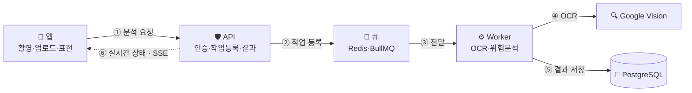
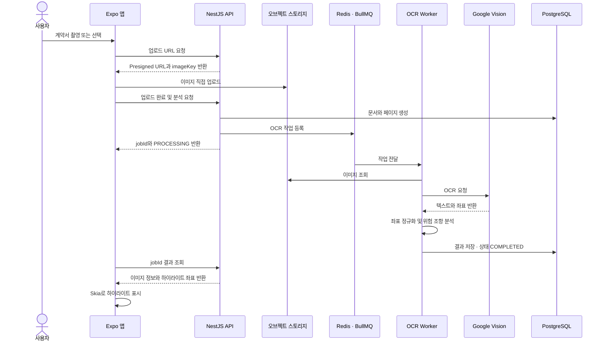

<div align="center">

# 📸 ClauseLens

**계약서·약관을 촬영하면, 불리할 수 있는 조항을 원본 이미지 위에 짚어주는 모바일 앱**

OCR로 텍스트와 좌표를 추출하고 위험 조항을 분석해, 확인이 필요한 부분을 사진 위에 하이라이트합니다.

<br>


</div>

> [!WARNING]
> ClauseLens의 분석 결과는 **참고 정보이며 법률 자문을 대체하지 않습니다.** 중요한 계약은 변호사 등 전문가의 검토를 권장합니다.

---

## 📑 목차

**[핵심 설계](#-핵심-설계)** · [프로젝트 현황](#-프로젝트-현황) · [핵심 기능](#-핵심-기능) · [모노레포 구조](#-모노레포-구조) · [이렇게 돌아갑니다](#-이렇게-돌아갑니다) · [인프라](#-인프라) · [개발 환경 · 실행](#-개발-환경--실행) · [로드맵](#-개발-로드맵)

> 더 깊은 설계·규칙 문서는 **[agents/](agents/README.md)** 에 계층별로 정리되어 있습니다(각 섹션 끝 "자세히" 링크).

---

## 🎯 핵심 설계

> 이 프로젝트에서 **집중해 공부·설계·구현한 것**을 중요도 순으로 먼저 정리합니다. 중심은 **① 서버 권위 비동기 분석 파이프라인**이고, 나머지는 그 위에서 함께 파고든 주제입니다.

### 1. 서버 권위 비동기 분석 파이프라인 ⭐ *(중심)*

> **앱은 표현만, 진실은 서버.** OCR 실행·위험 조항 판정은 전부 서버가 하고, 앱은 결과를 이미지 위에 그립니다.

- **비동기 분리** — API는 요청에 빠르게 답하고, 무거운 OCR·분석은 **큐 뒤의 Worker**가 처리 → 분석 중에도 앱이 멈추지 않음
- **구성요소**
  - **Google Cloud Vision** — 이미지에서 텍스트·좌표 추출(OCR)
  - **BullMQ + Redis** — 분석 작업 큐 · 진행 상태 pub/sub
  - **NestJS Worker** — 좌표 정규화 + 자동연장·위약금·해지제한 등 위험 조항 분석
  - **SSE** — 진행 상태 실시간 푸시(끊기면 앱이 GET으로 복원)
  - **React Native Skia** — 서버 좌표를 화면 비율로 변환해 사진 위 하이라이트 렌더
- **정합성** — 페이지 교체 시 `revision`을 올려 **옛 결과는 폐기**, 화면이 옛 이미지와 섞이지 않음



<sub>자세히 → [백엔드 아키텍처](agents/context/backend-architecture.md) · [분석 잡](agents/context/analysis-job.md) · [하이라이트 렌더링](agents/context/highlight-rendering.md) · [업로드·스토리지](agents/context/upload-storage.md)</sub>

### 2. 에이전틱 엔지니어링 하네스 *(함께 공부)*

> 두 AI(Claude·Codex)가 **같은 규칙**으로 협업하도록, 사람 개입을 게이트와 기록으로 강제한 장치.

- **작업 루프** — 이슈 → 브랜치 → spec(`prd`·`sdd`) → 구현 → **게이트(`checks.sh`)** → 저널 기록
- **강제 장치** — spec 없이 코드 수정 차단(hook) · 커밋 세 섹션 강제 · 원문 고정(`request.md`)
- **자동화** — PR 머지 시 이슈 완료 조건 체크박스를 spec 기준으로 자동 동기화

<sub>자세히 → [agents 개요](agents/README.md) · [하네스](agents/harness/README.md)</sub>

### 3. 보관·삭제 상태 머신 *(함께 설계)*

> 무료 분석 결과를 **임시 보관 → 저장 → 만료 삭제**로 안전하게 다루는 상태 전이.

- **상태** — `TEMPORARY`(완료 후 7일 보관) → `SAVED`(저장하기) / 7일 경과 → `DELETING` → 실삭제
- **안전장치** — CAS 전이 · 삭제 전 `DeletionAudit` 기록 · 멱등 삭제(S3 NotFound=성공) · 중단분 재개 가드
- **기본 거부** — 알 수 없는 상태는 노출하지 않음(default-deny)

<sub>자세히 → [도메인 맵](agents/context/domain-map.md) · spec [0068 저장 전환](agents/intent/specs/0068-save-retain-transition/) · [0069 실삭제](agents/intent/specs/0069-retention-hard-delete/)</sub>

### 4. 디자인 시스템 + FSD 프론트 *(함께 공부)*

> 토큰 기반 디자인 시스템과 Feature-Sliced 구조로 UI를 일관·확장 가능하게.

- **디자인 토큰** — 3층 토큰(Cobalt `#2563EB`) · 테마 경로(`vars()`) · 위험도 `tone` 도메인 분리
- **공용 UI** — shared-first 승격(ListRow·Badge·Button·ScreenHeader 등 `packages/ui`)
- **FSD** — 기능→기능 직접 import 금지, `app` 레이어에서 조합

<sub>자세히 → [아키텍처(디자인·FSD 결정)](agents/context/architecture.md) · [프론트 아키텍처](agents/context/frontend-architecture.md)</sub>

---

## 📊 프로젝트 현황

<sup>업데이트: **2026-10-10**</sup>

> **MVP 핵심 파이프라인 완성** — `촬영 → 업로드(presign) → 분석요청·큐·상태폴링(SSE) → OCR·위험조항 → 이미지 위 하이라이트 → 결과 저장·7일 보관`까지 **동작**합니다.
> 로그인·무료 횟수·분석 기록 재열람도 완료. 남은 작업은 **구독 결제(유료 저장)** 와 **특정 페이지 교체·재분석** 입니다.

| 영역 | 진행 |
| --- | --- |
| 🧱 기반 (모노레포·디자인시스템·인증) | **5 / 5 완료** |
| 🚀 기능 태스크 | **6 / 8 완료** · 1 진행 중(구독) · 1 대기 |
| 🎨 화면 리디자인 (로그인 후 9개 화면) | **완료** |
| 🔗 파이프라인 | 촬영 · 업로드 · 분석 · OCR · 하이라이트 · 저장·보관 **전 구간 동작** |

### 기능별 상태

| 기능 | 상태 | 태스크 | 이슈 · PR |
| --- | --- | --- | --- |
| 계약서 촬영·불러오기·Draft | ✅ 완료 | TASK-001 | #3 |
| S3 호환 직접 업로드 (presign) | ✅ 완료 | TASK-002 | #15·PR#59 / #61·PR#62 |
| 분석 요청·jobId 상태 폴링 (SSE) | ✅ 완료 | TASK-003 | #63·PR#64 |
| OCR·위험조항 결과 + Skia 하이라이트 | ✅ 완료 | TASK-004 | #68·PR#69 / #73·PR#75 |
| 로그인 (카카오)·무료 분석 횟수 | ✅ 완료 | TASK-005 | #36 / #90·PR#91 / #94·PR#95 |
| 분석 기록 재열람 + 7일 보관 | ✅ 완료 | TASK-008 | #96·PR#97 |
| 문서 저장·만료 실삭제 | ✅ 완료 | TASK-006 ②③ | #163 / #164 |
| 구독 결제 (유료 장기 저장) | ⬜ 대기 | TASK-006 ④ | #165 |
| 특정 페이지 교체·부분 재분석 | ⬜ 대기 | TASK-007 | — |

<sup>범례: ✅ 완료 · 🟡 부분/진행 중 · 🔜 다음 · ⬜ 대기</sup>

---

## ✨ 핵심 기능

1. **📷 담기** — 계약서 직접 촬영 · 갤러리 선택 · 여러 페이지 관리 및 특정 페이지 교체
2. **🔍 분석** — Google Vision OCR → 위험 조항 분석 → Skia로 이미지 위 하이라이트. 사용자당 **3회 무료**
3. **💾 저장** — 분석 결과를 저장하고 **7일간 보관** (영구 보관은 구독 기능으로 제공 예정)
4. **🔐 로그인** — 무료 분석 횟수 · 구독 상태 · 저장 문서 관리

---

## 🗂️ 모노레포 구조

**Turborepo + pnpm workspaces** — 앱·API·워커를 한 저장소에서 관리하고, 공용 계약·토큰·UI를 패키지로 공유합니다.

```
clause-lens/
├─ apps/
│  ├─ mobile/     # 📱 Expo · React Native 앱 (Feature-Sliced Design)
│  ├─ api/        # 🛡️ NestJS API 서버 (인증·문서·업로드·분석 요청)
│  └─ worker/     # ⚙️ OCR Worker (BullMQ 소비자, OcrPort 어댑터)
├─ packages/
│  ├─ contracts/  # 🔗 zod 계약 — api ↔ mobile 공유 타입·런타임 검증
│  ├─ db/         # 🗃️ Prisma 스키마 · 분석/보관 상태 전이 로직
│  ├─ tokens/     # 🎨 디자인 토큰 (3층 · NativeWind preset)
│  ├─ ui/         # 🧩 공유 UI 컴포넌트 (NativeWind)
│  └─ config/     # ⚙️ 공통 tsconfig 등
└─ agents/        # 🤖 에이전틱 엔지니어링 문서 (Intent·Context·Harness·Orchestration)
```

<sub>세 실행 주체(앱 · API · Worker)의 책임 경계는 → [아키텍처 요약](agents/context/architecture.md) · [백엔드](agents/context/backend-architecture.md) · [프론트](agents/context/frontend-architecture.md)</sub>

---

## 🔄 이렇게 돌아갑니다

> **한 줄 요약** — 앱이 이미지를 저장소에 직접 올리고 분석을 요청하면, 서버는 작업을 큐에 넣고 `jobId`를 바로 반환합니다. Worker가 OCR·분석해 DB에 저장하고, 앱은 상태를 받아 결과를 이미지 위에 하이라이트합니다.

**단계:** ① 촬영·업로드 → ② 분석 요청 → ③ 큐 등록(`jobId` 즉시 반환) → ④ Worker가 OCR(Vision)·위험조항 분석 → ⑤ 결과 DB 저장 → ⑥ 앱이 결과 조회 → Skia 하이라이트



### 분석 결과와 하이라이트

서버는 Vision의 OCR 텍스트·좌표를 받아 **위험 조항의 제목·설명·위험도**를 생성하고, 앱은 `boxes` 좌표를 화면 크기에 맞춰 Skia로 그립니다.

```json
{
  "jobId": "job_01",
  "status": "COMPLETED",
  "page": { "pageId": "page_02", "revision": 3, "imageWidth": 2480, "imageHeight": 3508 },
  "clauses": [
    {
      "type": "AUTO_RENEWAL",
      "title": "자동 연장",
      "text": "별도의 의사표시가 없는 경우 본 계약은 동일한 조건으로 자동 연장됩니다.",
      "riskLevel": "HIGH",
      "boxes": [{ "x": 312, "y": 1420, "width": 1710, "height": 108 }]
    }
  ]
}
```

```ts
const scaleX = displayedWidth / imageWidth;
const scaleY = displayedHeight / imageHeight;
const highlight = { x: box.x * scaleX, y: box.y * scaleY, width: box.width * scaleX, height: box.height * scaleY };
```

<sub>더 보기 → [페이지 교체·revision 흐름](agents/context/document-page.md) · [상태 결합·동기화(서버 기준 + 클라이언트 Draft)](agents/context/frontend-architecture.md) · [위험 조항 결과 모델](agents/context/clause-result.md)</sub>

---

## ☁️ 인프라

**배포는 Railway 단일 벤더입니다. AWS를 직접 사용하지 않습니다.** 백엔드(API·Worker)와 의존 서비스(DB·큐·스토리지)를 모두 Railway에서 운영하고, 외부 의존은 Google Cloud Vision 하나뿐입니다.

> 이 문서에서 **"S3"** 는 *S3 호환 오브젝트 스토리지*를 의미합니다. **프로덕션 = Railway Storage Bucket**, **로컬 개발 = MinIO**(docker-compose). 표준 S3 SDK라 엔드포인트·자격증명만 교체하면 R2·AWS S3로도 코드 변경 없이 이전됩니다.

| 기술 | 역할 | 위치 |
| --- | --- | --- |
| Railway Storage Bucket (S3 호환) | 계약서 원본 이미지 저장 · 로컬은 MinIO | Railway 관리형 / 로컬 docker-compose |
| Redis + BullMQ | OCR 비동기 작업 큐 · 상태 알림 pub/sub | Railway 관리형 Redis |
| PostgreSQL | 사용자·문서·페이지·작업 상태·분석 결과 저장 | Railway 관리형 |
| NestJS · OCR Worker | API 서버 · OCR 호출과 위험 조항 분석 | Railway 서비스 |
| Google Cloud Vision | 이미지에서 텍스트·좌표 추출 | 외부 API (유일한 외부 의존) |

<sub>결정 근거·대안·트레이드오프 → [아키텍처 — 인프라 결정(ADR)](agents/context/architecture.md)</sub>

---

## ⚙️ 개발 환경 · 실행

| 도구 | 버전 | | 도구 | 버전 |
| --- | --- | --- | --- | --- |
| Node.js | 22 | | React Native | 0.86.3 |
| pnpm | 11 | | React Native Skia | 2.6.2 |
| Expo SDK | 57 | | Java | 21 |
| Xcode | 26 | | CocoaPods | 1.17 |

```bash
pnpm install
pnpm exec expo start          # 개발 서버

pnpm exec expo run:ios        # 개발 빌드
pnpm exec expo run:android

pnpm dlx expo-doctor          # 환경 점검
```

**완료 게이트** — typecheck · build · prisma · 단위 테스트 등을 통과해야 "done"입니다.

```bash
bash agents/harness/evals/checks.sh
```

---

## 🗺️ 개발 로드맵

| # | 단계 | 상태 | 태스크 |
| --- | --- | --- | --- |
| 1 | 촬영·갤러리 이미지 선택 화면 | ✅ 완료 | TASK-001 |
| 2 | 여러 페이지와 Draft 상태 관리 | ✅ 완료 | TASK-001 |
| 3 | NestJS Presigned URL 연동·직접 업로드 | ✅ 완료 | TASK-002 |
| 4 | 분석 작업 요청과 상태 조회(SSE) | ✅ 완료 | TASK-003 |
| 5 | OCR·위험 조항 결과 + Skia 하이라이트 | ✅ 완료 | TASK-004 |
| 6 | 로그인과 무료 분석 횟수 | ✅ 완료 | TASK-005 |
| 7 | 분석 기록 재열람 + 7일 보관 | ✅ 완료 | TASK-008 |
| 8 | 문서 저장·만료 삭제 · 구독 결제 | 🟡 진행 중 | TASK-006 |
| 9 | 특정 페이지 교체·부분 재분석 | ⬜ 대기 | TASK-007 |
| 10 | 로그인 후 9개 화면 리디자인 | ✅ 완료 | TASK-U0~U5 |

---

<div align="center">
<sub>🤖 이 저장소는 Claude Code · Codex 두 AI가 동일한 규칙(<a href="AGENTS.md">AGENTS.md</a>)으로 협업하는 <b>에이전틱 엔지니어링</b> 방식으로 개발됩니다.</sub>
</div>
